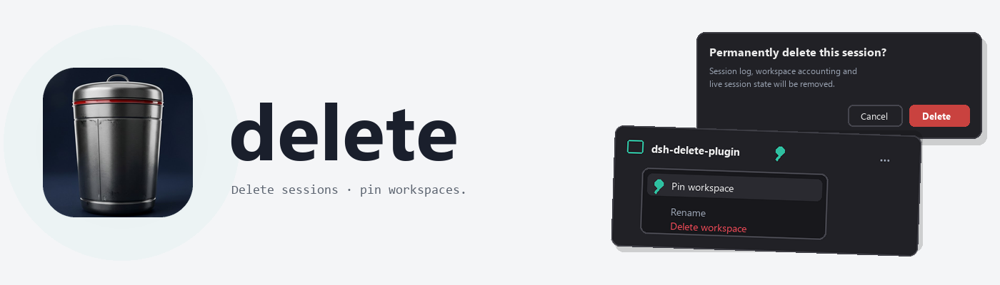

<picture>
  <source media="(prefers-color-scheme: dark)" srcset="assets/banner-dark.png">
  
</picture>

<br>

# dsh-delete-plugin

English | [中文](README.zh-CN.md)

     

A [DeepSeek Harness](https://github.com/deepseek-ai/deepseek-harness) plugin that adds two sidebar powers dsh does not ship together: **permanently deleting a session** from the session row menu, and **pinning a workspace** to the top of the workspace list (dsh only pins sessions today).

It does two things:

- **Delete session** — a danger item on the session row menu opens a risk-consent dialog naming exactly what will be removed (the session log, its workspace accounting, and live runtime state). On confirmation the host tears down an idle live session, physically removes the session directory, and re-checks persistence so the chat is gone for good. A session with a **running turn is refused** — stop it first.
- **Pin workspace** — a Pin/Unpin item on the workspace row menu. Pinned workspaces are surfaced ahead of the rest and wear a small pin badge; the pin set is durable and survives restarts. Unpinning returns the workspace to the unpinned group.

## Install

Straight from GitHub:

```sh
dsh plugin --profile web add github:adithyanraj03/dsh-delete-plugin
dsh --profile web
```

Or from the release tarball (in the profile directory):

```sh
pnpm add https://github.com/adithyanraj03/dsh-delete-plugin/releases/latest/download/plugin.tgz
```

then add `dsh-delete-plugin` to `dsh.profile.bundles` and restart the host.

### In the desktop app

Open **Plugins** (settings, left sidebar) → **Add plugin**, paste the repository address, click **Install**:

```
https://github.com/adithyanraj03/dsh-delete-plugin
```

The host half loads at startup, so restart the app after installing or upgrading. The package has no lifecycle scripts — there is nothing to approve with `pnpm approve-builds`.

> Never install the published package into a profile that already links a local copy of this plugin — you get two rows with the id `session-delete`.

## What you get

### Delete session

Right-click a session row (or open its **…** menu) → **Delete session**. The consent dialog lists what will be removed; **Cancel** keeps everything, **Delete** removes it permanently. If the session is mid-turn the host refuses with `session-running` and nothing is touched. After a successful delete the sidebar drops the row without a refresh; if it was the open session, the next one opens.

### Pin workspace

Right-click a workspace header (or open its **…** menu) → **Pin workspace**. The workspace moves to the top of the list and shows a pin badge; the menu item becomes **Unpin workspace**. Pins are stored in the plugin's own durable storage domain and are independent of dsh's session pins.

## Disclosure

- **Halves.** A host half (the deletion + the durable pin set, exposed as one `sessionDelete` remote service) and a browser half (the two menu items, the consent dialog, the pin badge and ordering). Both mount from one package.
- **No network, no telemetry.** The plugin makes no network calls and collects no telemetry of its own. Deletion runs locally through dsh's `subprocess` service; the pin set lives in local durable storage.
- **Deletion is permanent and gated.** Nothing is removed until you confirm the dialog. The host refuses sessions with a running turn, and only ever removes a directory owned by the named session (the session id must appear as a whole path segment).
- **Permissions.** The host acts with the user's own permissions through dsh's sanctioned services (`sessions`, `sessionPersistence`, `subprocess`, `workspaceRegistry`, `storageDomain`). The browser half only contributes menu items and calls the host RPC.
- **Uninstall.** Removing the plugin removes both menu actions immediately. The local pin set is inert without the plugin.

## Compatibility

| Host | Status |
| --- | --- |
| dsh 0.2.2-rc.1 (web profile + desktop) | Built against its session/workspace services. Host half verified mounting on a clean profile; the delete and pin RPCs verified against real services (storage round-trip, running-turn refusal, unknown-id validation). |
| older hosts without these services | The row degrades or cannot activate; nothing else is affected. |

## Development

```sh
npm test                     # wiring harness: name agreement + every shipped file exists
python scripts/make-banner.py  # regenerate the README banners (Pillow)
```

Layout: `src/index.js` (host: delete + pin remote service), `src/client.js` (browser: menus, consent dialog, badge, ordering), `cordis.patch.yml` (one insert row, id `session-delete`), `locale/` (en + zh plugin-manager metadata), `scripts/test-harness.mjs`.

## Prior art

Session deletion already exists in the ecosystem (`dsh-delete-session`, `dsh-session-delete`, `dsh-session-cleaner` on npm). This is an independent implementation that also adds workspace pinning; the deletion teardown follows the same agent-factory teardown sequence dsh itself uses.

## License

MIT © 2026 Adithya N Raj