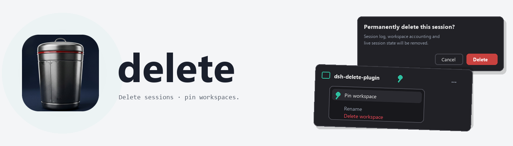

<picture>
  <source media="(prefers-color-scheme: dark)" srcset="assets/banner-dark.png">
  
</picture>

<br>

# dsh-delete-plugin

[English](README.md) | 中文

     

一个 [DeepSeek Harness](https://github.com/deepseek-ai/deepseek-harness) 插件，为侧边栏补上 dsh 尚未同时提供的两项能力：**从会话行菜单永久删除会话**，以及**把工作区置顶**（dsh 目前只能置顶会话）。

它做两件事：

- **删除会话** —— 会话行菜单上的危险项会弹出风险确认对话框，明确列出将被删除的内容（会话日志、工作区归属记录、运行时会话状态）。确认后，宿主会先拆除空闲的在线会话，物理删除会话目录，并复查持久化列表，确保聊天彻底消失。**正在运行回合的会话会被拒绝**——请先停止它。
- **置顶工作区** —— 工作区行菜单上的「置顶 / 取消置顶」项。被置顶的工作区会排在列表最前并显示一枚图钉徽标；**上下拖动已置顶的工作区即可重新排序**，顺序会被保存。置顶集合持久保存，重启后仍在。取消置顶后，工作区回到未置顶分组。

## 安装

从 npm 安装：

```sh
dsh plugin --profile web add dsh-delete-plugin
dsh --profile web
```

或直接从 GitHub 安装：

```sh
dsh plugin --profile web add github:adithyanraj03/dsh-delete-plugin
```

或使用发布 tarball（在 profile 目录中）：

```sh
pnpm add https://github.com/adithyanraj03/dsh-delete-plugin/releases/latest/download/plugin.tgz
```

然后把 `dsh-delete-plugin` 加入 `dsh.profile.bundles` 并重启宿主。

### 桌面应用

打开 **插件**（设置，左侧栏）→ **添加插件**，粘贴仓库地址，点击 **安装**：

```
https://github.com/adithyanraj03/dsh-delete-plugin
```

宿主半区在启动时加载，安装或升级后请重启应用。本包没有生命周期脚本——无需用 `pnpm approve-builds` 批准任何内容。

> 切勿在已链接本插件本地副本的 profile 中再安装发布包——会出现同一 id `session-delete` 的两行。

## 功能说明

### 删除会话

右键会话行（或打开它的 **…** 菜单）→ **删除会话**。确认对话框列出将被删除的内容；**取消**保留一切，**删除**永久移除。若会话正在回合中，宿主会以 `session-running` 拒绝，不做任何改动。删除成功后侧边栏无需刷新即移除该行；若它是当前打开的会话，则自动打开下一个。

### 置顶工作区

右键工作区标题（或打开它的 **…** 菜单）→ **置顶工作区**。该工作区移到列表最前并显示图钉徽标；菜单项变为 **取消置顶**。上下拖动已置顶的工作区即可重新排序——该顺序会被持久保存（不再弹回你置顶时的先后顺序）。置顶保存在插件自己的持久存储域中，与 dsh 的会话置顶相互独立。

## 披露

- **两半区。** 宿主半区（删除 + 持久置顶集合，作为一个 `sessionDelete` 远程服务暴露）与浏览器半区（两个菜单项、确认对话框、图钉徽标与排序）。两者由同一个包挂载。
- **无网络、无遥测。** 插件不发起任何网络调用，也不收集任何自身遥测。删除通过 dsh 的 `subprocess` 服务在本地执行；置顶集合保存在本地持久存储中。
- **删除是永久且受控的。** 在你确认对话框之前不会删除任何内容。宿主会拒绝正在运行回合的会话，且只删除归属于该会话的目录（会话 id 必须作为完整路径段出现）。
- **权限。** 宿主通过 dsh 的受认可服务（`sessions`、`sessionPersistence`、`subprocess`、`workspaceRegistry`、`storageDomain`）以用户自身权限行事。浏览器半区只贡献菜单项并调用宿主 RPC。
- **卸载。** 移除插件会立即移除两个菜单操作。没有插件时，本地置顶集合不再生效。

## 兼容性

| 宿主 | 状态 |
| --- | --- |
| dsh 0.2.2-rc.1（web profile + 桌面） | 基于其会话/工作区服务构建。宿主半区已在干净 profile 上验证挂载；删除与置顶 RPC 已针对真实服务验证（存储往返、运行回合拒绝、未知 id 校验）。 |
| 缺少这些服务的旧宿主 | 该行降级或无法激活；不影响其他部分。 |

## 开发

```sh
npm test                     # 接线测试：名称一致性 + 所有随包文件存在
python scripts/make-banner.py  # 重新生成 README 横幅（Pillow）
```

目录：`src/index.js`（宿主：删除 + 置顶远程服务）、`src/client.js`（浏览器：菜单、确认对话框、徽标、排序）、`cordis.patch.yml`（单插入行，id `session-delete`）、`locale/`（en + zh 插件管理器元数据）、`scripts/test-harness.mjs`。

## 已有同类插件

生态中已有会话删除插件（npm 上的 `dsh-delete-session`、`dsh-session-delete`、`dsh-session-cleaner`）。本插件是独立实现，并额外提供工作区置顶；删除时的拆除流程沿用 dsh 自身的 agent 工厂拆除顺序。

## 许可证

MIT © 2026 Adithya N Raj