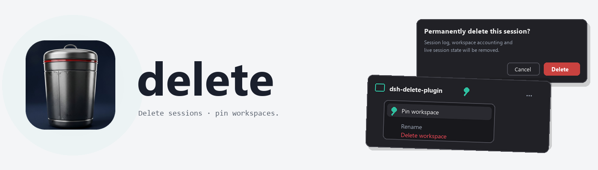

<picture>
  <source media="(prefers-color-scheme: dark)" srcset="https://raw.githubusercontent.com/adithyanraj03/dsh-delete-plugin/main/assets/banner-dark.png">
  
</picture>

# dsh-delete-plugin

Delete DSH sessions from the web sidebar behind an explicit consent gate, and pin
workspaces to the top of the list — two sidebar powers dsh does not ship together.

- **Delete session** — a danger item on the session row menu opens a risk-consent
  dialog naming what will be removed (session log, workspace accounting, live
  state). Running turns are refused; idle sessions are torn down and the session
  directory is physically removed, then persistence is re-checked.
- **Pin workspace** — a Pin/Unpin item on the workspace row menu surfaces pinned
  workspaces first with a pin badge; the pin set is durable across restarts.

**No network calls, no telemetry of its own.** Deletion runs locally through
dsh's sanctioned services and only on your confirmation.

## Install

```sh
dsh plugin --profile web add github:adithyanraj03/dsh-delete-plugin
```

[Repository](https://github.com/adithyanraj03/dsh-delete-plugin) ·
[中文说明](https://github.com/adithyanraj03/dsh-delete-plugin/blob/main/README.zh-CN.md) ·
[Releases](https://github.com/adithyanraj03/dsh-delete-plugin/releases)

MIT © 2026 Adithya N Raj